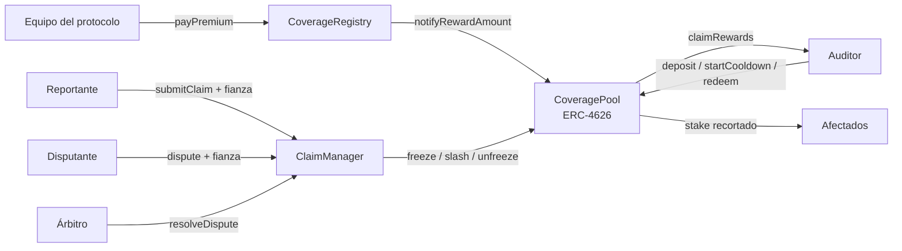
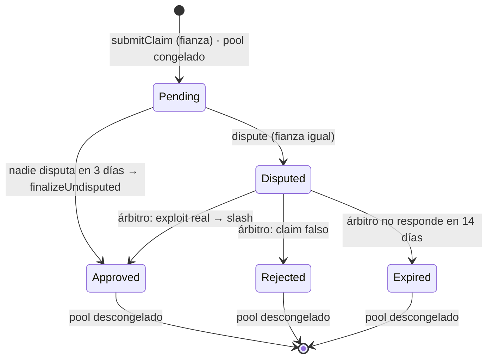

# AuditStake — *Stake your audit*

> Auditores que se juegan su stake: un seguro descentralizado de smart contracts en el que quien audita un protocolo respalda su trabajo con capital propio.

**Demo en vivo:** https://auditstake-six.vercel.app (Sepolia + MetaMask)
**Red:** Ethereum Sepolia · contratos verificados en Etherscan

Proyecto final del Máster en Desarrollo Blockchain (especialidad en seguridad DeFi) — Blockchain Accelerator.

---

## La idea

Hoy un auditor cobra por revisar un protocolo y, si después hay un exploit, no pierde nada. AuditStake alinea incentivos:

1. Cada protocolo cubierto tiene un **pool de cobertura**. Los auditores depositan stake (STK) en él.
2. El protocolo paga una **prima** (PRM) que se reparte en streaming entre los auditores del pool, en proporción a su stake.
3. Si ocurre un exploit, cualquiera puede abrir un **claim**. Si se aprueba, el stake del pool se **recorta (slashing)** para compensar a los afectados.

Resultado: los auditores ganan mientras el protocolo es seguro y pierden si no lo es. El stake funciona como una señal pública y medible de confianza en una auditoría.

## Arquitectura



| Contrato | Responsabilidad |
|---|---|
| `CoveragePool` | Vault ERC-4626 por protocolo. Shares intransferibles, cooldown de retirada, recompensas en streaming (estilo Synthetix) y slashing con tope. |
| `ClaimManager` | Claims optimistas: fianza, ventana de disputa, arbitraje con timeout. Es el único que puede congelar y recortar pools. |
| `CoverageRegistry` | Alta de pools (`addPool`), protocolo ↔ pool, y entrada única de primas (`payPremium`, solo el sponsor). `Ownable2Step`. |

### Ciclo de vida de un claim



Quien pierde la disputa pierde su fianza, que va al ganador. Si el árbitro no responde, se devuelven ambas fianzas.

### Parámetros del despliegue

| Parámetro | Valor |
|---|---|
| Cooldown de retirada | 7 días + ventana de retirada de 2 días |
| Slash máximo por claim | 50 % del stake congelado |
| Fianza de un claim | 10 BND |
| Ventana de disputa | 3 días |
| Timeout de arbitraje | 14 días |
| Duración de una prima | entre 7 y 365 días |

## Contratos desplegados (Sepolia)

| Contrato | Dirección |
|---|---|
| CoverageRegistry | [`0x36068Bce6917A1FfAF8ee683D610471d9CccD98e`](https://sepolia.etherscan.io/address/0x36068Bce6917A1FfAF8ee683D610471d9CccD98e#code) |
| ClaimManager | [`0x76AEAD4a1Ca33D13cEbdcD6252A8533bDc0F1ba0`](https://sepolia.etherscan.io/address/0x76AEAD4a1Ca33D13cEbdcD6252A8533bDc0F1ba0#code) |
| Pool — Lumen Lending | [`0x8cb015103dcA2f2563E2aD5A0ffdbA83BC7adA15`](https://sepolia.etherscan.io/address/0x8cb015103dcA2f2563E2aD5A0ffdbA83BC7adA15#code) |
| Pool — Orbit Bridge | [`0x0Cd46D34E3F910479b3E060AAF4FE5801cFE82aB`](https://sepolia.etherscan.io/address/0x0Cd46D34E3F910479b3E060AAF4FE5801cFE82aB#code) |
| STK (stake) | [`0x11C9cf0B2efB5Df182733664597E5cb9b5fEd8Ff`](https://sepolia.etherscan.io/address/0x11C9cf0B2efB5Df182733664597E5cb9b5fEd8Ff#code) |
| PRM (prima) | [`0xd8c9AC09F235f0cA0bA4EA5641Cb4f234b44ae12`](https://sepolia.etherscan.io/address/0xd8c9AC09F235f0cA0bA4EA5641Cb4f234b44ae12#code) |
| BND (fianza) | [`0x9965EbC7Cd470C556813E615b17B3D7838081e01`](https://sepolia.etherscan.io/address/0x9965EbC7Cd470C556813E615b17B3D7838081e01#code) |

Los tokens son `MockERC20` con `mint()` público, pensados solo para testnet. La demo incluye un faucet para que cualquiera pueda conseguir STK y BND.

## Cómo probar la demo

1. Abre https://auditstake-six.vercel.app y conecta MetaMask en la red Sepolia.
2. Consigue ETH de Sepolia para el gas en un faucet público (por ejemplo, el de Google Cloud).
3. Pulsa **Conseguir tokens** para recibir 1000 STK y 100 BND.
4. Entra en un pool, deposita STK y observa cómo crece tu prima en tiempo real.
5. En **Claims**, reporta un exploit (requiere fianza) y sigue el ciclo de vida.

En Sepolia los plazos son reales (7 días de cooldown, 3 de disputa). En local, con Anvil, la app incluye botones para adelantar el reloj.

## Seguridad

La seguridad es el centro del proyecto, no un añadido. Esta sección resume el modelo de amenazas y cómo se ha verificado.

### Modelo de amenazas

| # | Amenaza | Impacto | Mitigación |
|---|---|---|---|
| 1 | **Inflation attack** del primer depositante en el ERC-4626 (donar activos para que los siguientes reciban 0 shares) | Robo de depósitos | `_decimalsOffset() = 6`: shares virtuales que hacen el ataque económicamente inviable |
| 2 | **Huida ante un exploit**: retirar el stake en cuanto se detecta el ataque | El slashing no encuentra fondos | Cooldown de 7 días + ventana de 2. Al abrirse un claim el pool se **congela**: no hay depósitos ni retiradas |
| 3 | **Transferir shares** para esquivar el cooldown o el slashing | Elusión del cooldown | Shares **intransferibles** (override de `_update`) |
| 4 | **Griefing del cooldown**: depositar 1 wei a nombre de otro para reiniciarle la cuenta atrás | Bloqueo indefinido de retiradas ajenas | `ReceiverMustBeCaller`: solo puedes depositar para ti misma |
| 5 | **Dilución de la prima**: pagar 1 wei con duración de 365 días para estirar la prima en curso | Los auditores cobran mucho más despacio | `payPremium` solo para el sponsor del pool + duración acotada entre 7 y 365 días |
| 6 | **Slashing excesivo** (encadenar claims o pedir más de lo razonable) | Vaciar el pool | Tope acumulado (`maxSlashBps`) sobre una foto del stake al congelar. Un solo claim activo por pool |
| 7 | **Claims falsos** para congelar o recortar un pool | Pérdida para auditores honestos | Fianza que se pierde si te disputan con éxito. Cualquiera puede disputar |
| 8 | **Árbitro caído o malicioso que no responde** | Pool congelado para siempre (DoS) | `arbitrationTimeout` + `expireDispute`: pasado el plazo, cualquiera descongela el pool |
| 9 | **Reentrada** vía tokens con hooks | Estado inconsistente, doble cobro | `ReentrancyGuard` (como primer modificador), `SafeERC20` y checks-effects-interactions |
| 10 | **Pérdida de precisión** en las recompensas (shares con 6 decimales extra) | Recompensas que redondean a 0 | `PRECISION = 1e36` en el acumulador `rewardPerShare` |
| 11 | **Pools maliciosos** registrados en el sistema | Escapar de los claims o de las primas | `addPool` comprueba que el pool apunta a este registry y a este ClaimManager (`PoolMismatch`) |
| 12 | **Toma de control del registry** por un error al transferir la propiedad | Pérdida del control administrativo | `Ownable2Step`: el nuevo owner tiene que aceptar |

### Supuestos de confianza y riesgos residuales

- **Árbitro centralizado.** En esta versión el árbitro es una sola cuenta. En producción debería ser una multisig o un oráculo de disputas (Kleros, UMA). El timeout limita el daño que puede hacer al no responder, pero no un fallo deliberadamente injusto.
- **Modelo optimista.** Un claim que nadie disputa se aprueba solo. El sistema depende de que auditores o bots vigilen los claims durante la ventana de disputa.
- **Ventana de carrera.** Un auditor que ya esté dentro de su ventana de retirada puede retirar entre el exploit y la apertura del claim. El cooldown reduce esto a una fracción del stake, pero no lo elimina.
- **Coste del griefing.** Congelar un pool cuesta como mínimo la fianza (10 BND) y solo se pierde si alguien disputa.
- **Recompensas durante el congelado.** `claimRewards` sigue funcionando con el pool congelado. Es una decisión de diseño: la prima ya devengada pertenece al auditor.
- **Tokens no estándar.** No se soportan tokens con comisión por transferencia ni tokens rebase.
- **Tokens de prueba.** `MockERC20` permite que cualquiera acuñe. Válido solo para testnet.

### Verificación

- **106 tests en total, todos en verde.** Tests unitarios por contrato y por funcionalidad: setup, cooldown, recompensas, slashing, ClaimManager y registry, con escenarios de ataque.
- **Test de integración** del flujo completo: stake → prima → claim → disputa → slash.
- **Fuzzing** con 256 ejecuciones por test.
- **Invariant testing** con un handler y variables fantasma (128 ejecuciones × profundidad 50). Las 10 propiedades:
  - conservación del stake
  - shares respaldadas por activos
  - lo recortado va a los afectados
  - el slash nunca supera el tope
  - congelado ⇔ claim activo
  - sin retiradas con el pool congelado
  - solvencia de recompensas
  - conservación de primas
  - `rewardPerShare` monótono
  - contabilidad de fianzas
- **Mutation testing** manual: se inyectaron 4 bugs y la suite detectó los 4.
- **Análisis estático** con `forge lint`, con los avisos revisados y clasificados.
- **Dependencias del frontend** auditadas con `npm audit --omit=dev`: 0 vulnerabilidades en producción.

## Ejecutarlo en local

Requisitos: [Foundry](https://book.getfoundry.sh/) y Node.js 20 o superior.

```bash
git clone --recurse-submodules https://github.com/Noahlp125/auditstake.git
cd auditstake
forge build
forge test
```

Frontend contra una cadena local:

```bash
# Terminal 1
anvil

# Terminal 2: despliegue con la cuenta (0) que imprime Anvil
forge script script/Deploy.s.sol --rpc-url http://127.0.0.1:8545 \
  --private-key <clave-de-la-cuenta-0-de-anvil> --broadcast

# Terminal 3
cd frontend
npm install
echo "NEXT_PUBLIC_NETWORK=local" > .env.local
npm run dev   # http://localhost:3000
```

Para apuntar a Sepolia, usa `NEXT_PUBLIC_NETWORK=sepolia` en `frontend/.env.local`.

## Stack

- **Contratos:** Solidity 0.8.24, OpenZeppelin 5.1, Foundry (forge, cast, anvil)
- **Frontend:** Next.js 16, React 19, wagmi 3, viem 2, TanStack Query
- **Infraestructura:** Ethereum Sepolia, verificación en Etherscan, Vercel

## Estructura src/
CoveragePool.sol vault ERC-4626 con cooldown, recompensas y slashing
ClaimManager.sol claims optimistas con fianza y arbitraje
CoverageRegistry.sol alta de pools y primas
interfaces/
script/Deploy.s.sol despliegue + estado de demo
test/
unit/ tests por contrato
integration/ flujo completo
invariant/ invariantes + handler
deployments/ direcciones por red (las lee el frontend)
frontend/ app Next.js


## Licencia

MIT
